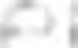
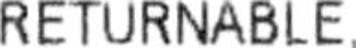
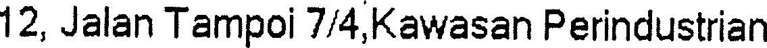
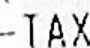
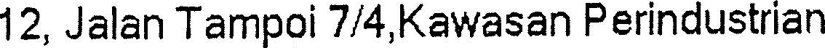
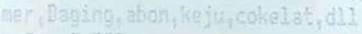
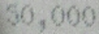
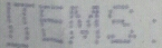
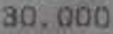
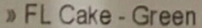

# OCR scanner: results

All numbers are from the **official test split** of each dataset, which was never used for training
or for any choice. Lower is better for CER and WER; higher is better for precision, recall and F1.
Reproduce with the three `python -m ocr.evaluate --system ...` commands in the README; the summaries
are in `docs/ocr/eval/`.

## Summary

- The pipeline works end to end: image -> page scanner -> text detection -> text recognition ->
  ordered text with word and line boxes.
- **Recogniser: fine-tuned, small gain on every dataset** (CER 3 to 22 % lower than pretrained).
- **Detector: not fine-tuned.** Its overfit test did not pass in five variants, so no long run was
  started and the pretrained detector is used. Detection numbers are therefore identical for
  "pretrained" and "fine-tuned".
- **End to end: slightly better on SROIE and CORD, slightly worse on FUNSD** (0.0944 to 0.0981).
- **The page scanner stage does not help on these datasets.** It is neutral on SROIE and makes CORD
  and FUNSD slightly worse. Without it the fine-tuned system is better than or equal to pretrained on
  all three.
- Both docTR systems are far ahead of Tesseract on all three datasets.

## Systems

| Name | Detector | Recogniser |
|---|---|---|
| Tesseract | Tesseract 5.3.4, `eng`, default page mode (`--psm 3`); single-word mode (`--psm 8`) for word crops | same |
| Pretrained | docTR `fast_base`, no fine-tuning | docTR `crnn_mobilenet_v3_large`, no fine-tuning |
| Fine-tuned | docTR `fast_base`, no fine-tuning (see above) | `crnn_mobilenet_v3_large` fine-tuned on FUNSD + SROIE + CORD train |

## Recognition (word crops cut with the ground-truth boxes)

| Dataset | Words | Tesseract CER / WER | Pretrained CER / WER | Fine-tuned CER / WER |
|---|---|---|---|---|
| FUNSD | 8,707 | 0.1839 / 0.5608 | 0.0516 / 0.1634 | **0.0500 / 0.1551** |
| SROIE | 38,542 | 0.2279 / 0.4246 | 0.1385 / 0.1534 | **0.1319 / 0.1267** |
| CORD | 2,356 | 0.2381 / 0.6297 | 0.0194 / 0.0876 | **0.0151 / 0.0713** |

## Detection (word boxes, IoU 0.5, detector on the raw image)

| Dataset | Tesseract P / R / F1 | docTR `fast_base` P / R / F1 (pretrained; used by both docTR systems) |
|---|---|---|
| FUNSD | 0.552 / 0.461 / 0.503 | 0.848 / 0.816 / 0.832 |
| SROIE | 0.747 / 0.796 / **0.770** | 0.696 / 0.745 / 0.719 |
| CORD | 0.420 / 0.377 / 0.397 | 0.835 / 0.965 / 0.895 |

Tesseract scores higher than the docTR detector on SROIE word boxes. SROIE's word boxes are derived
from its line boxes by a rule (see Caveats), so this row measures agreement with that rule as much as
detection quality.

## End to end (raw image to final text, full pages)

| Dataset | Pages | Tesseract CER / WER | Pretrained CER / WER | Fine-tuned CER / WER |
|---|---|---|---|---|
| FUNSD | 50 | 0.3601 / 0.6146 | **0.0944** / **0.3173** | 0.0981 / 0.3186 |
| SROIE | 361 | 0.2621 / 0.4902 | 0.1032 / 0.2131 | **0.1017 / 0.2067** |
| CORD | 100 | 0.7018 / 0.9604 | 0.1235 / 0.2798 | **0.1183 / 0.2673** |

Speed on 4 CPU cores: 2 to 4 s per page for the docTR pipeline, 0.1 to 0.3 s for Tesseract.

### Effect of the page scanner stage (same runs, crop never used vs. used when the checks pass)

| Dataset | System | Pages where the crop was used | CER / WER with the stage | CER / WER without it |
|---|---|---|---|---|
| FUNSD | Pretrained | 0 of 50 | 0.0944 / 0.3173 | 0.0944 / 0.3173 |
| FUNSD | Fine-tuned | 2 of 50 | 0.0981 / 0.3186 | 0.0943 / 0.3153 |
| SROIE | Pretrained | 31 of 361 | 0.1032 / 0.2131 | 0.1030 / 0.2181 |
| SROIE | Fine-tuned | 34 of 361 | 0.1017 / 0.2067 | 0.1017 / 0.2127 |
| CORD | Pretrained | 8 of 100 | 0.1235 / 0.2798 | 0.1191 / 0.2752 |
| CORD | Fine-tuned | 6 of 100 | 0.1183 / 0.2673 | 0.1145 / 0.2619 |

The stage lowers WER a little on SROIE and raises CER on CORD and on FUNSD (fine-tuned). These
datasets are flatbed scans and tightly framed receipt photos; none is a photo of a page lying on a
surface, which is what the scanner was trained for. **Its benefit on such photos is not measured
here**, because no public OCR dataset of that kind was available without registration.

An earlier version of the safety check was worse: on FUNSD the crop was used on 45 of 50 test pages
and raised the end-to-end CER from 0.0944 to 0.213. That run was stopped, the check was tightened
using validation pages only (NOTES.md, Step 2), and everything was rerun. The FUNSD test result of the
first version had been seen before the change; the threshold itself was chosen on validation.

## What is worse than baseline, stated plainly

- FUNSD end to end, fine-tuned (0.0981) vs pretrained (0.0944): worse, caused by the scanner crop on
  2 pages.
- The scanner stage on CORD: worse with it than without, for both systems.
- The first recognition run made FUNSD and CORD worse on validation (upper-case SROIE labels); it was
  discarded and is not in these tables (log in `docs/ocr/logs/`).
- Detector fine-tuning: F1 fell on the training pages themselves in every overfit variant
  (NOTES.md, Step 4). No fine-tuned detector exists.

## Failure examples (fine-tuned recogniser, test split)

A fixed random sample (seed 2026) of wrongly read words, from `python scripts/ocr_failures.py`.
FUNSD crops are not committed (research-only licence).

| Dataset | Crop | Prediction | Ground truth | Kind of error |
|---|---|---|---|---|
| SROIE |  | `P` | `:` | label box misaligned (derived word box) |
| SROIE |  | `RETURNABLE` | `ARE` | label box misaligned |
| SROIE |  | `12,JalanTampoi7/4.Kawasanperindustrian` | `12` | label box covers the whole line |
| SROIE |  | `TAX` | `-TAX` | leading punctuation missed |
| SROIE |  | `12,JalanTampoi7/4.KawasanPerindustrian` | `12` | label box covers the whole line |
| CORD |  | `mer,Daging.abon,keju,cokelat,di1` | `mer,Daging,abon,keju,cokelat,dll` | comma read as full stop; `ll` read as `i1` |
| CORD |  | `30,000` | `50,000` | digit confusion |
| CORD |  | `TEMS:` | `ITEMS:` | first letter missed |
| CORD |  | `30,000` | `30.000` | full stop read as comma |
| CORD |  | `FLCake-Green` | `FL Cake - Green` | one box holds several words; spaces lost |
| FUNSD | (not committed) | `PRIVILEGED,` | `PRIVILEGED.` | full stop read as comma |
| FUNSD | (not committed) | `MAVPROGBXLS` | `MAVPROGO` | characters invented at the end |
| FUNSD | (not committed) | `Wartnick,` | `Wartnick` | punctuation invented |
| FUNSD | (not committed) | `or` | `for` | first letter missed |

Patterns: punctuation (comma vs full stop) and first or last characters are the commonest real
errors. On SROIE a large share of the "errors" are label problems, not reading problems.

## Caveats on the numbers

- **SROIE word boxes are derived**, not annotated (line boxes split at the widest gaps). 4 of the 5
  sampled SROIE failures are bad label boxes. SROIE recognition and detection numbers therefore
  understate every system; the SROIE end-to-end numbers use the original line transcriptions and are
  not affected.
- **SROIE is scored without case** (its transcriptions are upper case whatever the print); FUNSD and
  CORD with case.
- **CORD annotates only the receipt fields**, so text outside them counts as false detections and as
  extra text end to end. Some CORD "words" hold several words in one box.
- **CORD is Indonesian**, not English; it tests digits and Latin-script reading, not English.
- End-to-end CER depends on reading order. Reference and prediction are ordered by the same rule, but
  multi-column FUNSD forms still lose points to ordering.
- Single runs with one seed (2026); no confidence intervals. The recognition gains are small enough
  that a different seed could change their size.

## What to try next

1. **Fine-tune the detector on a GPU.** The overfit test needs many more steps than a CPU allows; with
   a GPU, train all layers with docTR's reference training script and check F1 on the training pages
   first.
2. **Better SROIE word boxes**, for example by aligning the recogniser's output to the line
   transcription, instead of gap splitting. This would clean both the training labels and the test
   scores.
3. **Recognise text lines, not words**, on receipts: it removes the lost-space errors and the
   dependence on word boxes.
4. **Measure the scanner stage on its own ground**: OCR-annotated phone photos of pages on a desk
   (for example SmartDoc's OCR challenge, which needs registration). Until then, consider running
   with `--no-scanner` on scans and receipts.
5. **Synthetic text lines** with punctuation-heavy content (amounts, dates) to attack the comma and
   full-stop confusions.
